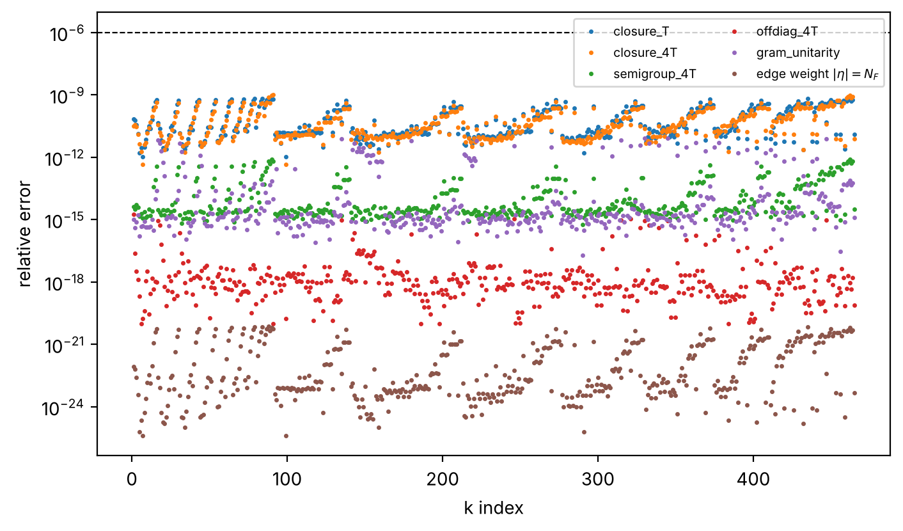
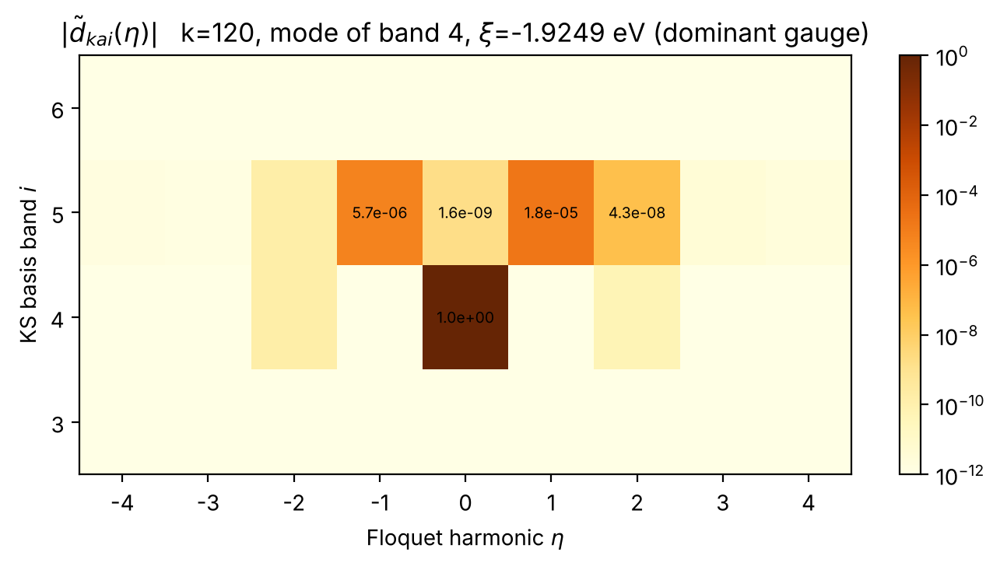
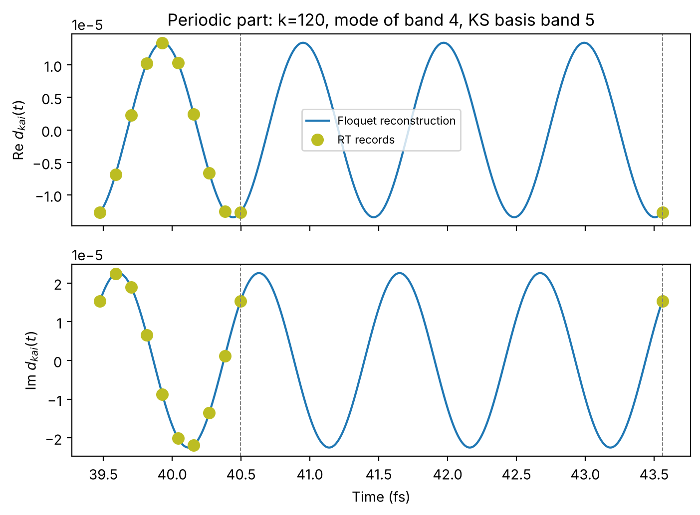
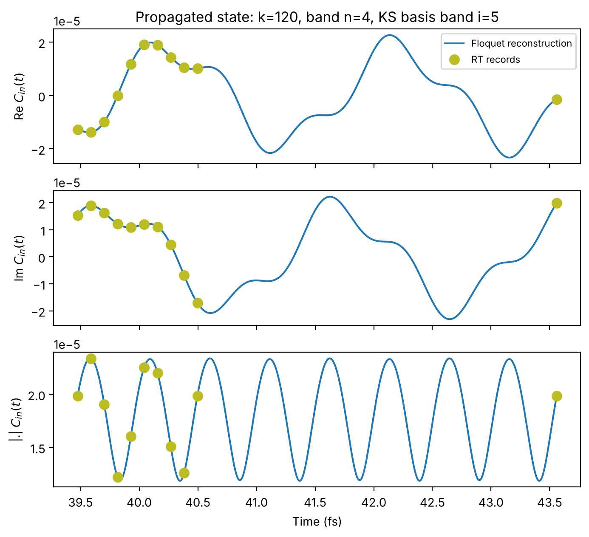
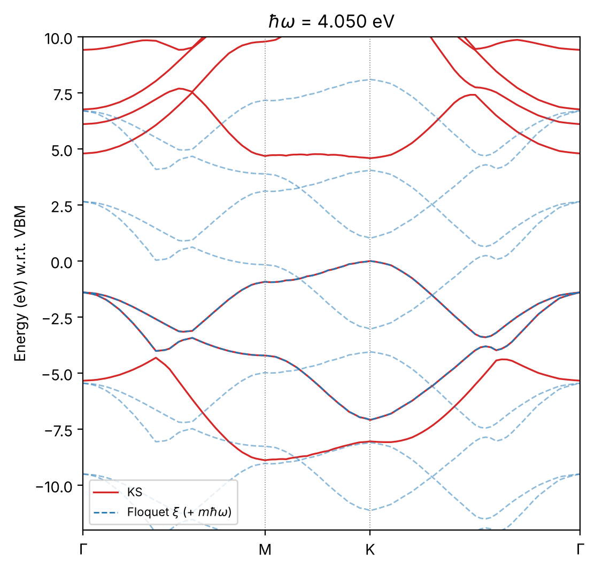
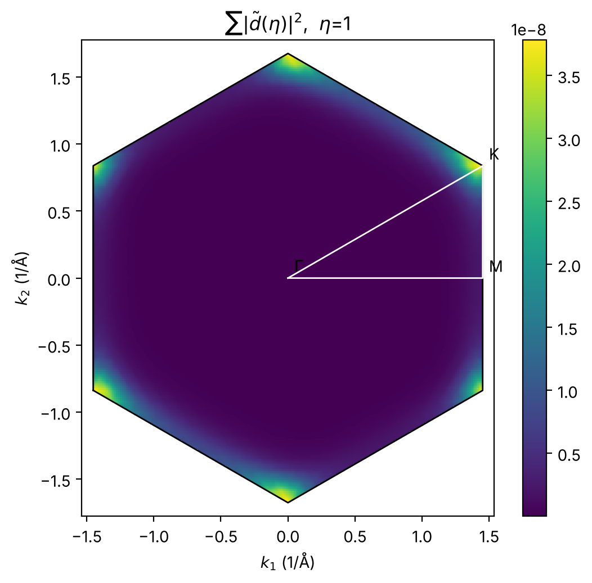
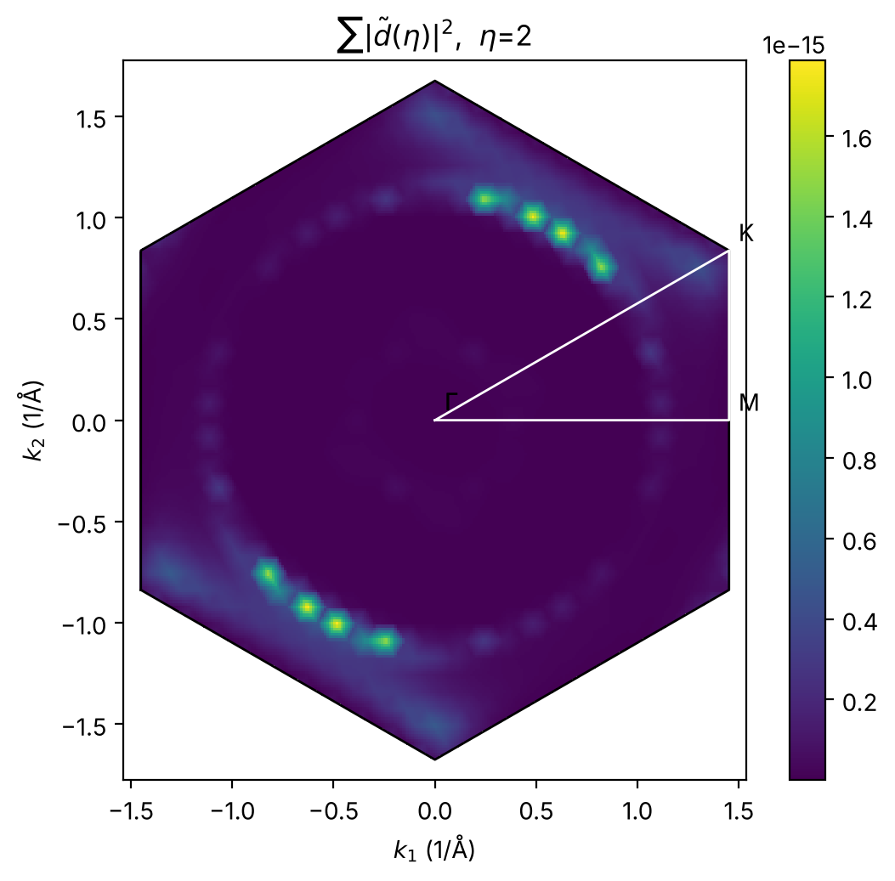
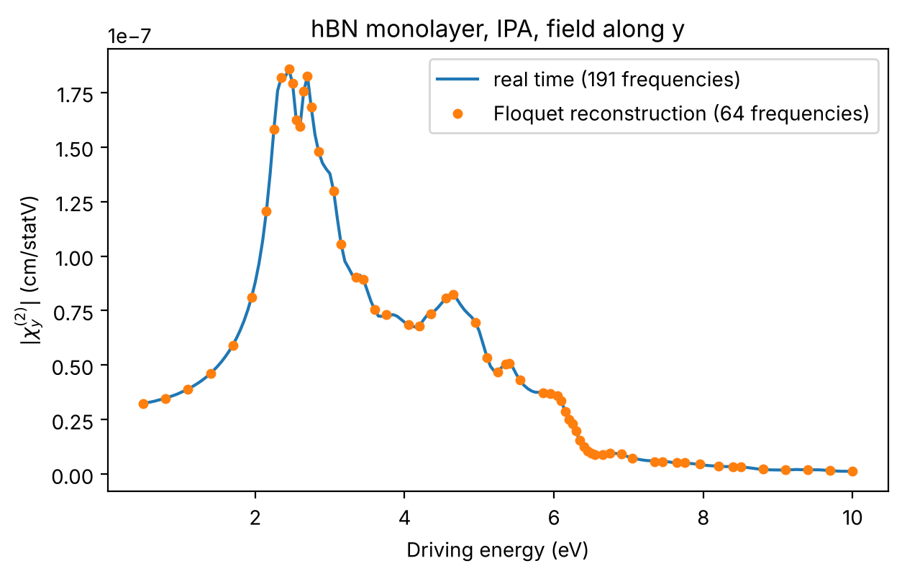

# Floquet analysis of real-time simulations: direct monodromy method

#### Ashwin Pillai, Myrta Grüning, Ignacio M. Alliati and Claudio Attaccalite

This tutorial shows how to extract Floquet quasienergies and Floquet–Kohn–Sham (F–KS) coefficients from a real-time `yambo_nl` (Lumen) simulation with the class `FloquetAnalysis` of `yambopy/nl/vb_postprocessing.py`, how to plot them along the band structure and in the Brillouin zone, and how to rebuild the second-harmonic response from the Floquet states.

It replaces the single-state secant search of the previous tutorial (`vb_postprocessing_tutorial`, class `VbPP`, still available) with the *direct monodromy* formulation: all propagated valence states at a given **k** are treated together, so that crossings and degeneracies are handled without any iterative search, and the result comes with a set of quantitative consistency checks.

The example is monolayer hBN in the independent-particle approximation (30×30×1 k-grid, `NLBands = 3–6`, propagated valence bands 3 and 4) driven at ħω = 4.05 eV by a `SOFTSIN` field polarised along *y*.

## 0. Theory in a nutshell

In the real-time run the occupied Bloch states are propagated and expanded on the unperturbed KS states,

$$|v_{\mathbf k n}(t)\rangle=\sum_i C_{in}(t,\mathbf k)\,|u_{\mathbf k i}\rangle .$$

In the periodic steady state each propagated state is a combination of Floquet modes $a$,

$$\psi_{\mathbf k a}(t)=e^{-i\xi_{\mathbf k a}(t-t_0)}\sum_{\eta=-N_F}^{N_F}e^{-i\eta\omega(t-t_0)}\sum_i\tilde d_{\mathbf k a i}(\eta)\,u_{\mathbf k i},$$

with quasienergy $\xi_{\mathbf k a}$ (defined modulo ħω) and F–KS (Sambe) coefficients $\tilde d_{\mathbf k a i}(\eta)$. The sideband $\eta$ carries the energy $\xi+\eta\omega$.

With $C_0=C_{\mathbf k}(t_0)$, $C_T=C_{\mathbf k}(t_0+T)$:

$$G=C_0^\dagger C_0,\qquad L=G^{-1}C_0^\dagger C_T,\qquad L\,\Gamma=\Gamma\,\mathrm{diag}(\zeta_a),\qquad \xi_{\mathbf k a}=-\frac{1}{T}\arg\zeta_a .$$

$L$ is the one-period propagator (monodromy matrix) restricted to the propagated subspace. The periodic part $d_{\mathbf k a i}(t)=e^{+i\xi_{\mathbf k a}(t-t_0)}\sum_nC_{in}(t,\mathbf k)\Gamma_{na}$ is sampled at the $2N_F+1$ phases $t_s=t_0+sT/(2N_F+1)$, and a finite discrete Fourier transform gives $\tilde d_{\mathbf k a i}(\eta)$ exactly.

The extraction is checked with:

| check (`fa.diagnostics`) | meaning |
|:--|:--|
| `timing_errors` | the stored times are exactly on the phase grid, at $t_0+T$ and at $t_0+4T$ |
| `gram_condition`, `eigenvector_condition` | conditioning of $G$ and $\Gamma$ |
| `closure_T`, `closure_4T` | $\lVert C_0L-C_T\rVert/\lVert C_T\rVert$: the propagated subspace is closed |
| `semigroup_4T`, `predicted_4T` | $L_4\simeq L^4$, with $L_4=G^{-1}C_0^\dagger C_{4T}$, checked on data that was **not** used for the fit |
| `offdiag_4T` | off-diagonal weight of $\Gamma^{-1}L_4\Gamma$ |
| `edge_fraction` | weight at $\lvert\eta\rvert=N_F$ (truncation of the Fourier series) |
| `reconstruction` | every stored record rebuilt from $\xi$, $\tilde d$ and $\Gamma$ |

Note that the $2N_F+1$ phase samples are reproduced *by construction*, so the reconstruction is a meaningful test only because the $T$ and $4T$ records are also included.

## 1. Real-time run with Floquet sampling

The analysis needs **one `yambo_nl` run per driving frequency**. Generate the input as usual (`yambo_nl -nl n -V nl -F Y_FLQ.in`) and set at least:

```
% NLBands
 3 | 6 |                           # KS basis; must contain all the propagated occupied bands
%
NLtime= -1.000000 fs               # keep the default: the code fixes the length needed for the sampling
NLDamping= 0.200000 eV
FLOrder= 4                         # Floquet order N_F: 2*N_F+1 phase samples + records at T and 4T
Field1_Freq= 4.050000 eV           # one frequency only (no NLEnRange/NLEnSteps loop)
Field1_Int= 1000.0 kWLm2
Field1_kind= "SOFTSIN"             # SIN or SOFTSIN
% Field1_Dir
 0.0 | 1.0 | 0.0 |
%
```

The propagation has to be done in a `SAVE` whose symmetries are compatible with the field (`ypp -y` / `FixSymm`); the same `SAVE` must be passed to the analysis. Run with `yambo_nl -F Y_FLQ.in -J FLQ`. The folder `FLQ` then contains

```
ndb.Nonlinear  ndb.RT_V_bands  ndb.RT_V_bands_K_section  ndb.Overlap  ...
```

`ndb.RT_V_bands*` contain the $C_{in}(t,\mathbf k)$ at the $2N_F+1+2$ sampled times (record 0, the initial time, is not used); `ndb.Overlap` is needed only for the Berry-phase reconstruction of Section 5. To compute a spectrum, repeat the run in folders `FLQ_000`, `FLQ_001`, … for the frequencies of interest.

## 2. Quasienergies and F–KS coefficients

Script: [`examples/01_quasienergies.py`](examples/01_quasienergies.py)

```python
from yambopy import FloquetAnalysis
fa = FloquetAnalysis(folder='.', calc='FLQ', save='SAVE')
print(fa)
```

The databases are read, the monodromy matrices are diagonalised for all k-points at once, the Sambe coefficients are computed and all the tests are performed (a `FloquetError` is raised if a test fails; use `strict=False` to only get a warning). The printout is

```
 * * * Floquet analysis (direct monodromy) * * *
 * * * Floquet samples (ndb.RT_V_bands) * * *
Path           : ./FLQ
Records        : 12 (original indices [0, 1, 2, 3, 4, 5, 6, 7, 8, 9, 10, 11])
Number of k    : 465
KS basis bands : 3 - 6
Stored slots   : 4
Floquet order  : 4  (9 phase samples)
Frequency      : 4.050000 eV
Period         : 1.021152 fs
Propagated bands  : [3, 4]
t0                : 39.475101 fs
Sambe gauge       : dominant
KS/RT offset      : -0.758196 eV (-VBM mod omega); from data: -0.757652 eV
Timing errors / T : phase_grid=3.7e-15, T=2.9e-15, fourT=8.9e-16

 Consistency checks (min / mean / max over k)
   gram_condition         1.000e+00  1.000e+00  1.000e+00
   eigenvector_condition  1.000e+00  1.000e+00  1.000e+00
   closure_T              1.070e-12  1.223e-10  6.693e-10
   closure_4T             4.515e-13  9.570e-11  1.043e-09
   semigroup_4T           5.769e-16  4.532e-14  7.970e-13
   predicted_4T           4.515e-13  9.570e-11  1.043e-09
   offdiag_4T             3.164e-21  3.067e-17  1.733e-15
   gram_unitarity         1.864e-17  3.596e-13  8.119e-12
   multiplier_modulus     0.000e+00  2.891e-15  5.351e-14
   edge_fraction          3.431e-28  3.770e-22  7.163e-21
   spectral_moment        4.862e-28  5.826e-11  2.416e-09
   reconstruction         6.701e-15  3.519e-11  2.089e-10

 All tests passed  : True
```

An already loaded `YamboVbandsDB` can also be used: `FloquetAnalysis(vbdb=mydb, save='SAVE')`.

`fa.plot_checks()` shows the diagnostics for every k-point; the dashed line is the tolerance (`tol=1e-6`):



**Floquet modes and bands.** There are as many Floquet modes per k as propagated bands. Mode `a` is associated with the propagated band `fa.active_bands[a]` by maximising $|\Gamma_{na}|^2$; the confidence of the association is in `fa.mode_weight` (1 = unambiguous, 0.5 for a two-fold degeneracy, as at Γ for bands 3–4). All methods take the k-point index and the *band* (1-based, as in yambo).

**Quasienergies.** `fa.quasienergies(gauge=...)` returns an array (nk, nmodes) in eV:

- `'principal'`: $\xi\in(-\omega/2,\omega/2]$;
- `'sambe'`: the branch used for the F–KS coefficients;
- `'ks'` (default): the branch closest to the KS energy of the associated band. `yambo_nl` puts the valence-band maximum at zero, so the energy reference of the RT run differs from that of `SAVE` by `fa.ks_offset_au` = −E_VBM modulo ħω (here −0.758 eV); this offset is removed, so that $\xi$ can be compared directly with `fa.ks_energies()`. It is a single number: the k-dependent field-induced shifts $\xi-E_{KS}$ are not touched. As a check, `fa.median_offset_au` estimates the same offset from the data (−0.7577 eV: the 0.5 meV difference is the average field-induced shift).

`fa.report('quasienergies.dat')` writes, for every k and band, the KS energy, the quasienergy, their difference, the mode weight, the edge weight and the closure error:

```
#  k  band   E_KS[eV]      xi[eV]      xi-E_KS[eV]  weight   edge      closure_T
   1    3    -4.692204    -4.692157   4.7223e-05  0.7502  8.65e-23  6.86e-11
   1    4    -4.692204    -4.692157   4.7223e-05  0.7502  3.45e-28  6.86e-11
   2    3    -4.783163    -4.783106   5.7035e-05  1.0000  6.43e-23  5.87e-11
```

**F–KS coefficients.** `eta, d = fa.sambe(kpt, band)` returns $\tilde d_{\mathbf k a i}(\eta)$ as an array (2N_F+1, n_basis); the full array is `fa.Lambda[k, a, eta, i]` with `fa.harmonics = [-4,...,4]`.

Because $\xi$ is defined modulo ħω, a branch shift $\xi\to\xi+m\omega$ relabels the sidebands, $\tilde d(\eta)\to\tilde d(\eta+m)$. The default gauge `gauge='dominant'` chooses the branch so that the largest component is at $\eta=0$: $\eta$ then counts the photons exchanged with the initial band, and $\eta=\pm1$ ($\pm2$) on the conduction bands are the one-photon (two-photon, SHG) components, for every k. `gauge='principal'` and `gauge='compact'` (the minimal-edge-weight criterion of the stand-alone `FLQuasi.py` script) are also available; with `'compact'` the dominant component can sit at different $\eta$ at different k when the edge weights are at noise level, so maps of a given $\eta$ should be done in the `'dominant'` gauge.

```python
fa.plot_sambe(120, 4)
```



For k = 120 the mode originating from band 4 has weight 1 on band 4 at η = 0, the one-photon components on band 5 at η = ±1 (~10⁻⁵) and the two-photon components at η = ±2 (~10⁻⁸). The resonant terms (η > 0 on the conduction band, energy ξ + ηω) are larger than the antiresonant ones.

**Time dependence.** `fa.plot_periodic_part(kpt, band, basis_band)` compares the Fourier reconstruction of the periodic part $d_{\mathbf k a i}(t)$ with the values obtained directly from the stored records, including the records at $t_0+T$ and $t_0+4T$ (dashed lines), which are not used in the Fourier transform:



`fa.plot_propagated_state(kpt, band, basis_band)` does the same for the physical coefficient $C_{in}(t,\mathbf k)$, rebuilt from all the Floquet modes through $\Gamma^{-1}$:



Everything (quasienergies in all gauges, Γ, Λ, the diagnostics and the raw coefficients) can be stored with `fa.to_npz('floquet_FLQ.npz')`.

## 3. Floquet bands

Script: [`examples/02_floquet_bands.py`](examples/02_floquet_bands.py)

```python
from qepy.lattice import Path
from yambopy import FloquetAnalysis, FloquetBZ
fa = FloquetAnalysis(folder='.', calc='FLQ', save='SAVE')
bz = FloquetBZ('SAVE')
path = Path([ [[0.0,0.0,0.0],'$\\Gamma$'], [[0.5,0.0,0.0],'M'],
              [[1./3.,1./3.,0.0],'K'], [[0.0,0.0,0.0],'$\\Gamma$']], [30,15,35])
fa.plot_bands(path, npoints=40, bz=bz, ks_bands=range(1,9), replicas=2, ylim=(-12,10))
```

`FloquetBZ` reads the `SAVE`, expands the IBZ to the full zone and detects the regular k-grid. Along the path the Floquet multipliers $e^{-i\xi T}$, which do not depend on the branch, are interpolated on the periodic grid and the branch closest to the KS band of the associated band is selected; this avoids spurious jumps of $\xi$ between neighbouring k-points. The solid lines are the KS bands, the dashed lines are the Floquet quasienergies of bands 3–4 and their replicas $\xi+m\hbar\omega$, $|m|\le2$ (the replicas are the same states, not additional solutions):



At this intensity the quasienergies follow the KS bands (`xi - E_KS` in the report is between 0 and 6.1 meV). The numbers can be obtained without plotting with `fa.bands_on_path(path, ...)`.

## 4. Sidebands in the Brillouin zone

Script: [`examples/03_sideband_BZ.py`](examples/03_sideband_BZ.py)

`fa.sideband_weight(eta, basis_bands, bands)` returns, for every k of the IBZ,

$$W_\eta(\mathbf k)=\sum_{a\in\text{bands}}\ \sum_{i\in\text{basis\_bands}}|\tilde d_{\mathbf k a i}(\eta)|^2 ,$$

and `fa.plot_sideband_bz` draws it in the first Brillouin zone (`bz.expand(w)` gives the values on the full grid). By default the sum runs over all modes, which is invariant under rotations inside degenerate subspaces; mode-resolved maps should be used with care close to degeneracies.

```python
for eta in (1, 2):
    fa.plot_sideband_bz(eta, basis_bands=[5, 6], bz=bz, path=path)
```

| η = 1 (one photon) | η = 2 (two photons, SHG) |
|:--:|:--:|
|  |  |

The one-photon weight is spread over the zone, while the two-photon weight at ħω = 4.05 eV (2ħω = 8.1 eV) is concentrated on a ring of k-points, most of which have a valence–conduction transition within a few tenths of eV of 2ħω, with the anisotropy set by the field direction (y). This is a weight of Floquet coefficients, **not** an exciton wavefunction; for an excitonic calculation (TD-SHF/BSE) it can be compared with the k-space distribution of the BSE excitons.

## 5. Second harmonic from the Floquet states

Script: [`examples/04_shg_from_floquet.py`](examples/04_shg_from_floquet.py)

As a final test the Berry-phase polarization is computed from the Floquet-reconstructed states on a dense time grid and the harmonic response is extracted with the same normalisation as the real-time analysis (`Xn_from_sine`). This needs `ndb.Overlap` (overlaps between neighbouring k-points) in the calculation folder.

```python
from yambopy import FloquetAnalysis, FloquetBZ, YamboNLDB
bz   = FloquetBZ('SAVE')
fa   = FloquetAnalysis(folder='.', calc='FLQ', save='SAVE')
nldb = YamboNLDB(calc='FLQ')
fa.setup_berry(bz=bz, field_direction=nldb.Efield[0]['versor'])
print(fa.validate_berry(nldb))          # stored RT states vs polarization in ndb.Nonlinear
chi2, info = fa.harmonic_response(nldb, order=2)
```

- `setup_berry` checks that the expansion IBZ → BZ uses only unitary symmetries that leave the field invariant (otherwise regenerate the `SAVE` with `FixSymm`). The occupied bands below `NLBands` are kept frozen in the Berry determinant.
- `validate_berry` compares the Berry polarization of the stored states with the one written by `yambo_nl` at the same times.
- `harmonic_response` doubles the number of time points until $\chi^{(n)}$ changes by less than `sampling_tol`. With `symmetry='auto'` the polarization is symmetrised with the field-preserving symmetries if `yambo_nl` did so. It returns the three field-contracted components (x, y, z) in cm/statV for SHG.

For a set of frequencies (`FLQ_000`, `FLQ_001`, …):

```python
import glob
from yambopy import floquet_harmonic_spectrum
E_fl, X_fl = floquet_harmonic_spectrum(sorted(glob.glob('FLQ_[0-9][0-9][0-9]')), save='SAVE', order=2)
```

The result for hBN (IPA, 64 Floquet frequencies) compared with the real-time spectrum (191 frequencies):



The two spectra agree within 0.5 % (complex L² relative difference at the 64 common frequencies). This is a test of the internal consistency of the Floquet reconstruction, not a convergence test with respect to k-points, bands, field intensity or `FLOrder`.

### Interband and intraband parts

`polarization_decomposition` splits each harmonic of the polarization, $\mathbf P(t)=\sum_N\mathbf P^{(N)}e^{-iN\omega(t-t_0)}$, into

$$\mathbf P^{(N)}_{\rm inter}=-\frac{f_s}{N_k\Omega}\sum_{\mathbf k}\sum_{cv}\Big[\mathbf r_{vc}\,\rho^{(N)}_{cv}+\mathbf r_{cv}\,\rho^{(N)}_{vc}\Big],\qquad
\rho^{(N)}_{ij,\mathbf k}=\sum_a w_a\sum_\eta\tilde d_{\mathbf kai}(\eta+N)\,\tilde d^*_{\mathbf kaj}(\eta),$$

and $\mathbf P^{(N)}_{\rm intra}=\mathbf P^{(N)}_{\rm Berry}-\mathbf P^{(N)}_{\rm inter}$, i.e. the elements within the valence and conduction manifolds plus the covariant derivative $i\nabla_{\mathbf k}$ acting on the Floquet coefficients. The interband position $\mathbf r_{cv}$ is obtained from the same `ndb.Overlap` used for the Berry phase, with a gauge-covariant central difference (`interband_position`), so no dipole database is needed and the phases are consistent with the Berry phase. All parts converge as $O(\Delta k^2)$.

```python
dec = fa.polarization_decomposition(orders=(1, 2), nldb=nldb)
print(dec['chi']['total'][1], dec['chi']['inter'][1], dec['chi']['intra'][1])   # SHG, cm/statV
print(dec['inter_consistency'], dec['occupation_offdiag'])                      # steady-state checks
rho2 = fa.density_matrix_harmonics(2)          # rho^(2)_ij,k in the KS basis window (no spin)
```

`inter_consistency` compares $\mathbf P_{\rm inter}$ computed from $\rho^{(N)}$ with the one computed from $\rho(t)=C(t)C(t)^\dagger$ of the reconstructed states, and `occupation_offdiag` is the weight of the off-diagonal $W_{ab}$ neglected in $\rho^{(N)}$; both vanish in the periodic steady state.

### Excitonic analysis

`FloquetExcitons` projects the harmonics of the interband coherence on the BSE excitons $A^\lambda_{cv\mathbf k}$,

$$X^{(N)}_\lambda=\sum_{\mathbf kcv}\big(A^\lambda_{cv\mathbf k}\big)^*\rho^{(N)}_{cv,\mathbf k},\qquad
\mathbf P^{(N)}_{\rm inter}=-\frac{f_s}{N_k\Omega}\sum_\lambda\Big[\mathbf d_\lambda X^{(N)}_\lambda+\mathbf d^*_\lambda\big(X^{(-N)}_\lambda\big)^*\Big],$$

$$\mathbf P^{(N)}_{\rm intra}\simeq-\frac{f_s}{N_k\Omega}\sum_{N'}\sum_{\lambda\lambda'}\big(X^{(N'-N)}_{\lambda'}\big)^*\,\mathbf M_{\lambda'\lambda}\,X^{(N')}_\lambda ,$$

with the exciton dipoles $\mathbf d_\lambda$ and the exciton-to-exciton dipoles $\mathbf M_{\lambda\lambda'}=\sum_{\mathbf k}\mathrm{Tr}[B^{\lambda\dagger}_{\mathbf k}\,i\nabla_{\mathbf k}B^{\lambda'}_{\mathbf k}]$, $B^\lambda_{\mathbf k}=\sum_{cv}A^\lambda_{cv\mathbf k}|u_{\mathbf kc}\rangle\langle u_{\mathbf kv}|$. Both are computed from `ndb.Overlap` with gauge-covariant finite differences. The intraband expression uses $\rho^2=\rho$ to express $\rho_{cc'}$ and $\rho_{vv'}$ through $\rho_{cv}$ and is accurate to $O(\rho_{cv}^2)$ relative.

The BSE (TDA, `WRbsWF`) must be computed with the **same** `SAVE` (k-grid, bands, wave functions and thus phases) as the real-time run; its conduction bands must lie within `NLBands`.

```python
from yambopy import FloquetExcitons
fx = FloquetExcitons.from_yambo(fa, filename='ndb.BS_diago_Q1', folder='BSE')
X2 = fx.amplitudes(2)                     # X^(2)_lambda
d  = fx.dipoles(); M = fx.transition_dipoles()   # Cartesian, Bohr
r  = fx.polarization(orders=(1, 2), nldb=nldb, pathways=True)
print(r['residual_inter'], r['residual_intra'], r['residual_total'])
E, c = fx.cumulative(N=2, component=1)    # cumulative sum over excitons (energy order), y component
```

- `inter_per_exciton` gives the contribution of each exciton to $\mathbf P^{(N)}_{\rm inter}$ (resonant + anti-resonant), `intra_pathways[N]` the matrix of contributions of each pair $(\lambda',\lambda)$ to $\mathbf P^{(N)}_{\rm intra}$.
- `residual_inter` vanishes for a complete excitonic basis (all eigenvectors) and measures the truncation otherwise; `residual_intra` also contains the $O(\rho_{cv}^2)$ terms and the $O(\Delta k^2)$ discretisation; `residual_total` compares inter + intra with the full Berry-phase $\mathbf P^{(N)}$.
- The k-points of the BSE eigenvectors are taken in the order of the full BZ of `YamboLatticeDB` (the convention used throughout yambopy).

## 6. Practical remarks

- Only the propagated occupied subspace is represented: there are no conduction-band Floquet modes. Their weight appears in the sidebands of the valence modes.
- If `edge_fraction` is not negligible, increase `FLOrder`; if `closure_T`/`closure_4T` are large, the system has not reached a periodic steady state within the sampled window (check `NLtime`, damping, field switch-on) or `NLBands` is too small.
- The finite-field coefficients divided by $E^n$ are effective responses: an intensity scan is needed to call them perturbative $\chi^{(n)}$.
- Convention: the sideband $\eta$ has energy $\xi+\eta\omega$. In the stand-alone scripts `FLQuasi.py`/`FLQ_HG.py` the opposite sign was used, $\Lambda_{\text{here}}(\eta)=\Lambda_{\text{scripts}}(-\eta)$.
- For a propagated state that coincides with a single Floquet mode, the legacy secant search (`VbPP.find_qe(method='optimize')`) gives the same quasienergies (differences below 10⁻⁶ eV on this dataset); the monodromy method also handles mixed/degenerate states, needs no initial guess or iteration and comes with the independent T/4T checks. The legacy `method='ratio'` is not reliable with the non-uniform Floquet sampling (phase grid + T + 4T) and should not be used.
- The legacy interface of the previous tutorial (`VbPP`, `findallk_qe`, `calc_rho`, `get_qebands_interpolate`, `plot_2D_kdist`) is unchanged.
